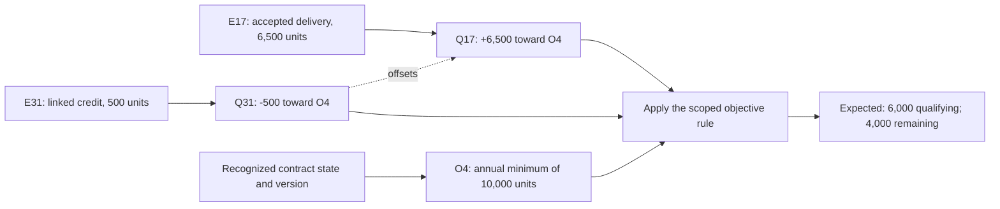

# A first review: trace one contractual result

Use this guide to inspect one existing synthetic case and identify what a real workflow would need to supply. No implementation is needed to give useful feedback.

The [frozen profile](profile/v0.1/HT-Minimum-Normative-Profile-Draft-0.1.md) governs requirements. The numbers and identifiers below come from section 23 of the [frozen corpus](profile/v0.1/HT-Reference-Consequence-Corpus-v0.1.md). This is an editorial walkthrough of that case.

## Start with the existing case

The annual minimum is 10,000 units. Authoritative accepted delivery E17 supplies 6,500 units and qualifies toward obligation O4 through Q17. Authoritative credit/return E31 reduces that exact contribution by 500 units through Q31, which offsets Q17.

| Contribution to O4 | Effect |
|---|---:|
| Q17, based on E17 | +6,500 units |
| Q31, based on E31 and linked to Q17 | -500 units |
| Expected qualifying fulfillment | 6,000 units |
| Expected remaining minimum | 4,000 units |

The important connection is the offset target. The credit is tied to the identified contribution, not matched solely by its amount.

The diagram illustrates the existing bindings and arithmetic. The table below identifies the remaining source requirements; it is not a complete populated fixture.

## Follow the six roles

| Profile role | What this case gives us | What authoritative modeling must identify |
|---|---|---|
| ContractStateAnchor | A minimum of 10,000 units is stipulated. | Recognized contract identity, state/version, effective scope and material amendment mapping. |
| NormativePosition | O4 is the target obligation. | Its binding to the valid contract state and applicable scope. |
| ObjectiveRule | E17 qualifies; E31 offsets 500 units of Q17; the corpus supplies the expected totals. | Rule ID/version, explicit required inputs and deterministic meaning, applicability and required authority classes. |
| EvidenceAssertion | E17 and E31 are stipulated authoritative inputs. | Recognized issuers, assertion meaning, subject binding, material time/scope and durable source references. |
| QualificationRelation | Q17 contributes +6,500 to O4; Q31 contributes -500 and offsets Q17. | The qualification basis and applicable scope, with exact evidence, position and offset references. |
| ConsequenceAssertion | The expected values are 6,000 qualifying and 4,000 remaining units. | Target, unit, effective scope, computed/adjudicated classification, profile version and complete material lineage. |

Concrete dates, state identifiers, recognized authority bindings and rule versions are not filled in by this walkthrough. They must come from authoritative case material. The public semantic corpus is not a complete executable fixture suite.

## Check the boundary

- Can every material input be traced to its recognized source and correct version?
- Does the credit actually offset Q17 for O4 in the applicable scope?
- Are all material predicates explicit and deterministic, or does a recognized determination supply an interpretive input?
- Would a replacement retain the state, rule meaning, evidence, qualifications and any material determinations needed to reconstruct the result?

A computed result requires explicit authoritative modeled inputs. A consequence materially dependent on an adjudicated determination retains adjudicated provenance. Unresolved material predicates require the defined escalation.

These two sample records do not establish that a real year's records are complete. Where a proposed query requires a contractual non-event, the profile requires complete authoritative coverage of the relevant evidence universe; an empty search is insufficient.

For the existing wrong-target, authority and lineage boundaries, consult corpus cases A05, A10 and A12. This guide adds no new variants or expected outcomes.

## Give one useful piece of feedback

Open an issue with one concrete source gap, disputed binding or workflow example:

1. **Decision:** what exact result would someone use, and what do they do today?
2. **Source:** what existing document or record could supply the material input?
3. **Authority:** who could confirm that meaning or assertion, and on what basis?
4. **Consequence:** which value, scope, classification or material basis changes if the assumption is wrong?
5. **Unknown:** what is still missing rather than inferred?

A structural description is enough to start; use only information you are permitted to disclose.

## Turn feedback into evidence

An editorial or packaging error can be corrected directly. A source/modeling gap needs the missing input or accountable confirmation. An implementation issue needs evidence of the actual implementation behavior. A claimed semantic disagreement should preserve the equivalent inputs and material output difference before deciding its cause.

Questions and criticisms are welcome before a complete reproduction exists. The [contribution guidance](CONTRIBUTING.md) sets the separate threshold for revising frozen semantics. The [results and limits](RESULTS.md) describe the existing studies; this walkthrough is not a new evaluation.
